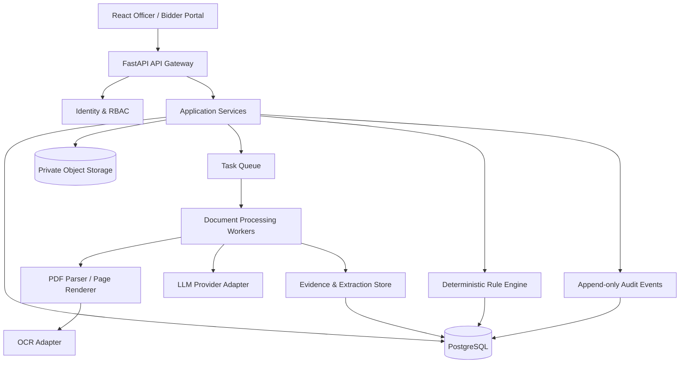

# ARCHITECTURE.md — System architecture

## 1. Product boundary

The platform assists tender authorities with:
- tender document ingestion and rulebook drafting;
- bidder submission intake;
- document classification and evidence extraction;
- OCR and manual review;
- deterministic compliance and technical evaluation;
- staged commercial bid opening and comparison;
- officer review, approval, and audit.

It is not an autonomous procurement authority and does not replace the official e-procurement system unless a separately authorized integration is built.

## 2. High-level architecture



## 3. Recommended modular monolith first

Start with a modular monolith, not microservices. Separate modules and worker processes by responsibility. This is easier to build and demonstrate in a hackathon while keeping clear boundaries for later extraction into services.

Suggested backend packages:

```text
backend/
  app/
    main.py
    api/
      v1/
        tenders.py
        rulebooks.py
        bidder_submissions.py
        evaluations.py
        commercial.py
        reviews.py
        audit.py
    core/
      config.py
      security.py
      permissions.py
      logging.py
    domain/
      enums.py
      entities/
      policies/
      state_machines/
    modules/
      tender_intake/
      rulebook/
      submissions/
      document_processing/
      extraction/
      evidence/
      evaluation/
      commercial/
      human_review/
      audit/
      integrations/
    infrastructure/
      db/
      storage/
      queue/
      llm/
      ocr/
      pdf/
    workers/
      tasks.py
    tests/
```

Frontend:

```text
frontend/
  src/
    app/
    components/
      layout/
      data-table/
      evidence-viewer/
      status/
    features/
      tenders/
      rulebooks/
      bidders/
      document-review/
      technical-evaluation/
      commercial-opening/
      comparison/
      audit/
    lib/
    routes/
    types/
```

## 4. Processing flow

### A. Tender setup
1. Authority creates tender metadata and uploads tender declaration, technical specifications, commercial terms, annexures, corrigenda, and schedules.
2. Intake service stores immutable originals, computes SHA-256 hashes, records metadata, and creates a document manifest.
3. Parser extracts digital text and page structure; scanned pages are rendered and routed to OCR.
4. Tender Intelligence Agent proposes document classes, required bidder documents, fields, units, source clauses, criterion types, and workflow configuration.
5. Rulebook validator checks completeness, contradictions, missing operators/thresholds, undefined weights, and commercial leakage.
6. Tender officer reviews each criterion and approves a version. Approval freezes the version. Any amendment creates a new version and records effective scope.

### B. Bid submission
1. Bidder uploads files into the correct configured envelope/cover/section.
2. Server records submission timestamp, uploader, file hashes, and immutable original.
3. Technical and commercial objects are stored in separate namespaces with separate access policies.
4. The platform checks file type, size, malware, encryption/password protection, and PDF integrity.
5. The technical pipeline starts only for technical artifacts. Commercial files remain sealed.

### C. Document understanding and extraction
1. Document classifier proposes document type.
2. Page processor selects text extraction, OCR, or both.
3. Extraction agents receive only the relevant document type, approved field schema, and necessary tender context.
4. Agent returns normalized values plus evidence references, confidence, ambiguity flags, and raw text.
5. Validator checks types, units, ranges, evidence coordinates, and cross-document consistency.
6. Low confidence, handwriting, conflicting values, missing evidence, or interpretation-heavy cases enter human review.
7. Human edits create a new extraction revision; original AI output remains preserved.

### D. Evaluation
1. Evaluation service loads only the approved rulebook version.
2. It resolves each criterion against approved evidence revisions.
3. Deterministic operators calculate `PASS`, `FAIL`, `MISSING`, `UNREADABLE`, `AMBIGUOUS`, `NOT_APPLICABLE`, or `PENDING_REVIEW`.
4. Any rule requiring expert judgment stays `PENDING_OFFICER_DECISION`.
5. Technical summary and comparative tables are generated with evidence drill-down.
6. Officer records acceptance, rejection, clarification (only where permitted), or override with reason and signature.

### E. Commercial stage
1. Commercial opening requires the configured opening date/time, authorized role, and technical-stage eligibility state.
2. Opening event is explicit, audited, and ideally requires dual authorization for production.
3. Before opening, commercial values are not queryable by technical evaluators or extraction agents.
4. After opening, commercial extraction/validation and comparison run according to the tender's configured price schedule and evaluation formula.
5. Combined ranking is produced only if the tender defines the formula and weights. Otherwise display technical and commercial views separately and mark combined ranking unavailable pending officer-defined tender rule.

## 5. Agent orchestration

Use a workflow/state-machine orchestrator, not an unrestricted swarm. Each agent is a bounded task with typed input/output and no direct database writes.

Recommended orchestration:
- Rulebook drafting workflow
- Bid intake workflow
- Per-document extraction workflow
- Review queue workflow
- Evaluation workflow
- Commercial opening workflow

All writes happen through application services after validation and authorization.

## 6. Deterministic evaluation engine

The evaluation engine must not use an LLM to calculate pass/fail or ranking. It consumes normalized evidence and approved criteria.

Supported operators should include:
- `EQ`, `NEQ`
- `GT`, `GTE`, `LT`, `LTE`
- `IN`, `NOT_IN`
- `BETWEEN`
- `CONTAINS`, `REGEX` (carefully constrained)
- `DATE_VALID_ON`, `DATE_VALID_AT`
- `DOCUMENT_PRESENT`
- `SIGNATURE_PRESENT`
- `ISSUER_IN_ALLOWED_LIST`
- `COUNT_GTE`
- `SUM_GTE`
- `PERCENTAGE_ABOVE_BELOW`
- `MANUAL_REVIEW_REQUIRED`

Do not assume all tenders use all operators. Every operator needs tests and a human-readable explanation.

## 7. Ranking model

Keep three distinct outputs:
- Technical qualification/score (only when the tender defines measurable scoring).
- Commercial ranking (only after authorized opening, using the tender's actual evaluated-price method).
- Combined ranking (only when a published tender formula defines it).

Never create an arbitrary `technical 70% + commercial 30%` formula. A "technical quality" ordering must not be invented from subjective agent judgments. If the tender defines pass/fail technical responsiveness, show pass/fail and the reasons; optionally show factual non-scored metrics separately.

## 8. UI information architecture

Formal government portal, desktop-first but responsive:
- Global header: organization emblem placeholder, portal name, tender ID, signed-in user and role.
- Left navigation: Dashboard, Tenders, Rulebooks, Bid Submissions, Technical Scrutiny, Commercial Opening, Comparative Statements, Audit Trail, Administration.
- Neutral palette, high contrast, restrained navy/blue/grey, clear typography, accessible focus states.
- Use tables with sticky headers, filters, export controls, column chooser, and pagination.
- Use explicit labels: `AI extracted`, `Officer verified`, `Rule evaluated`, `Officer approved`.
- Evidence viewer: PDF page on left, extracted fields and rule observations on right; click evidence to highlight page region.
- Do not use a chat-only UI. An assistant panel may explain a clause, but must cite source page/paragraph and never mutate the rulebook without officer approval.

## 9. Non-functional requirements

- Tenant and tender isolation.
- Encryption in transit and at rest.
- Immutable original submissions and append-only audit events.
- Configurable retention and archival policies.
- Backup/restore and disaster recovery.
- Observability without logging document contents, secrets, or prices.
- Performance targets to be established with realistic scanned tender PDFs.
- Accessibility target: WCAG 2.1 AA as a design goal.
