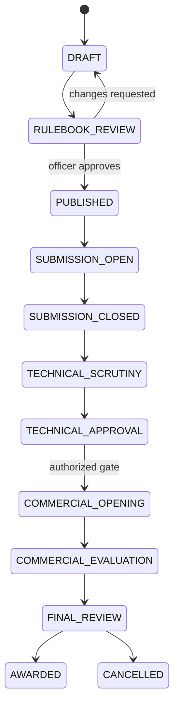

# Domain model and lifecycle

## Core entities

- `Organization`: procuring entity / department / DISCOM / GETCO / GSECL / GUVNL.
- `User`, `Role`, `Permission`, `OrganizationMembership`.
- `Tender`: identity, title, procuring organization, dates, tender type, status, workflow configuration.
- `TenderArtifact`: immutable uploaded tender file, SHA-256, media type, source, version, pages.
- `Corrigendum`: amendment, publication/effective time, affected clauses/criteria.
- `Rulebook`: tender-specific structured criteria container.
- `RulebookVersion`: immutable draft/approved version, author, approver, timestamps, source hashes.
- `Criterion`: criterion ID, category, scope, operator, expected value, unit, mandatory/optional, weight if explicitly specified, source clause.
- `DocumentRequirement`: document class, required status, submission channel, required fields, linked criteria.
- `Bidder`: bidder identity and organization details.
- `BidSubmission`: immutable submission event, received time, deadline check, package hash.
- `BidArtifact`: technical/commercial/other classification, storage namespace, source metadata.
- `ExtractedField`: canonical key, raw/normalized value, unit, evidence reference, confidence, extraction revision.
- `EvidenceReference`: artifact ID, page, bounding box, text span, image crop reference.
- `ReviewTask`: reason, priority, assigned reviewer, status, decision, comments.
- `EvaluationRun`: rulebook version, engine version, input evidence revision IDs, deterministic result hash.
- `CriterionResult`: status, actual value, expected value, explanation, evidence links.
- `CommercialOpeningEvent`: authorized opening, time, officers, eligible bidder set, audit reference.
- `CommercialOffer`: sealed until opening; price components and source.
- `RankingSnapshot`: method, source formula, run time, included bidders, result.
- `OfficerDecision`: technical decision, commercial decision, award recommendation/decision, reason, approver.
- `AuditEvent`: append-only actor/action/object/time/previous-value/new-value/reason/correlation ID.

## Criterion result statuses

Use explicit states:
- `PASS`
- `FAIL`
- `MISSING`
- `UNREADABLE`
- `AMBIGUOUS`
- `PENDING_REVIEW`
- `NOT_APPLICABLE`
- `NOT_EVALUATED`
- `OVERRIDDEN_BY_OFFICER` (must retain underlying rule result)

Do not collapse `MISSING`, `UNREADABLE`, and `FAIL`.

## Tender lifecycle

Actual states and transitions must be configurable where procurement rules differ. Do not force a tender to use every state.

## Bid lifecycle

`DRAFT_UPLOAD -> SUBMITTED -> LOCKED -> PROCESSING -> REVIEW_REQUIRED / READY_FOR_EVALUATION -> TECHNICAL_EVALUATED -> TECHNICALLY_RESPONSIVE / NON_RESPONSIVE / OFFICER_DECISION_PENDING -> COMMERCIAL_ELIGIBLE -> COMMERCIAL_OPENED -> COMMERCIAL_EVALUATED -> FINAL_DECISION`

A bidder cannot modify a locked submission after deadline. A clarification is a separate event and is permitted only under tender-specific policy.

## Tender workflow configuration

At minimum:
- `submission_mode`: portal upload / physical receipt / hybrid / external e-procurement integration.
- `technical_submission_channel`
- `commercial_submission_channel`
- `commercial_separation_mode`: separate upload / separate envelope / external portal / sealed data store.
- `technical_opening_policy`
- `commercial_opening_policy`
- `commercial_mechanism`: sealed_bid / online_price_schedule / reverse_auction / other (must be tender-authorized).
- `clarification_policy`
- `late_submission_policy`
- `fee_emd_policy`
- `technical_evaluation_method`
- `commercial_evaluation_method`
- `combined_evaluation_method`
- `timezone`
- `dual_control_required`

Never assume `reverse_auction` or live editable prices from the general product concept.
